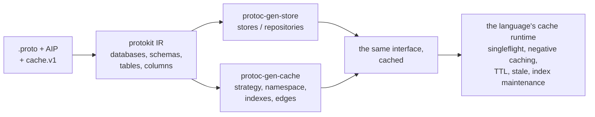
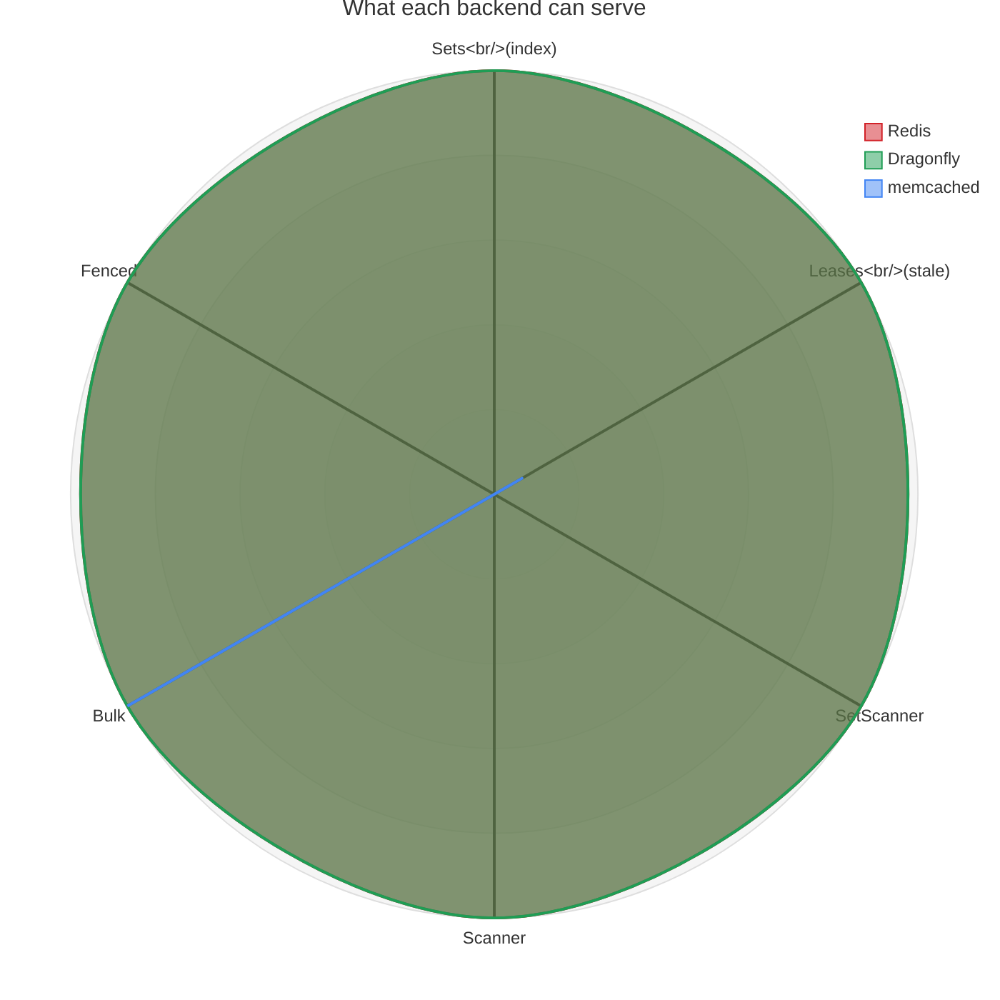
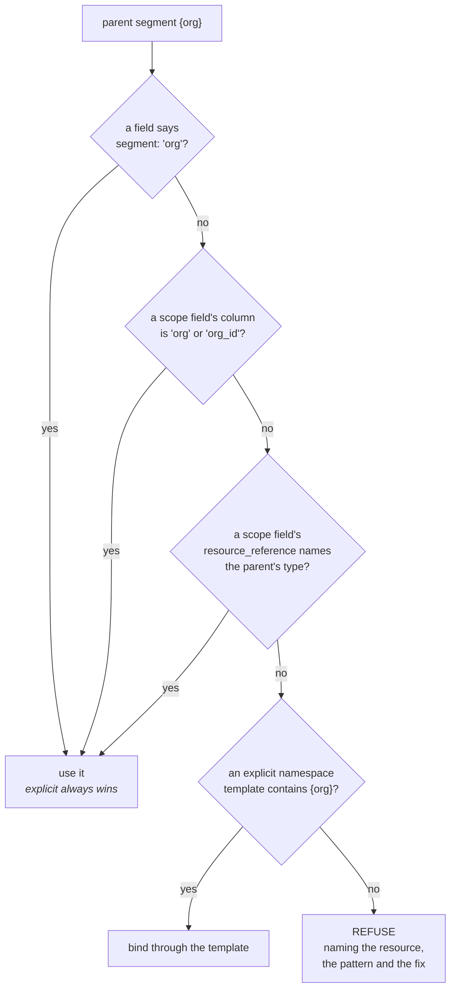
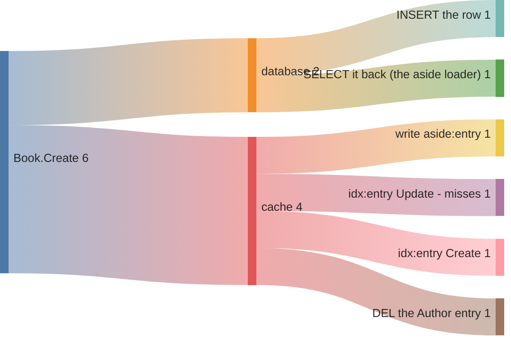
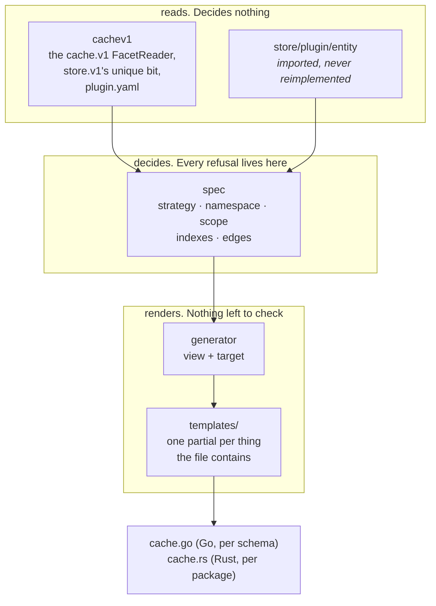

<h1 align="center">protoc-gen-cache</h1>

<p align="center">
  <strong>Your data layer, cached, without your callers knowing.</strong>
  protoc-gen-cache is a <code>protoc</code> plugin that turns
  <code>cache.v1</code> annotations on your AIP protobuf into typed read-through
  caches in front of the stores and repositories
  <a href="https://github.com/the-protobuf-project/store">protoc-gen-store</a>
  generates, in <strong>Go</strong> and <strong>Rust</strong>, and
  <strong>refuses to emit</strong> when the result would let one tenant read
  another's rows.
</p>

<p align="center">
  <a href="LICENSE"></a>
  <a href="https://github.com/the-protobuf-project/cache/releases"></a>
  <a href="https://github.com/the-protobuf-project/cache/actions/workflows/test.yaml"></a>
  <a href="https://github.com/the-protobuf-project/cache/actions/workflows/lint.yaml"></a>
  
</p>

> [!CAUTION]
> Early development. The generated output may change between versions. Pin a
> release tag in CI and review the diff before shipping a regenerated cache —
> a changed namespace orphans a live cache on deploy.

## Contents

- [Why](#why)
- [Languages](#languages)
- [The problem it actually solves](#the-problem-it-actually-solves)
- [Setup](#setup)
  - [1. Install the plugin](#1-install-the-plugin)
  - [2. Add the annotations](#2-add-the-annotations)
  - [3. Annotate what to cache](#3-annotate-what-to-cache)
  - [4. Generate and wire it](#4-generate-and-wire-it): [Go](#go-setup) · [Rust](#rust-setup)
  - [Troubleshooting](#troubleshooting)
- [Strategies](#strategies)
- [Annotations](#annotations)
- [Scoping and the namespace](#scoping-and-the-namespace)
- [What a write reaches](#what-a-write-reaches)
- [Caching lists](#caching-lists)
- [Two paths, and they do not stack](#two-paths-and-they-do-not-stack)
- [Go](#go)
- [Rust](#rust)
- [Architecture](#architecture)
- [What it does not do](#what-it-does-not-do)
- [Adding a language](#adding-a-language)
- [Development](#development)
- [License](#license)

## Why

**A cache in front of a database is four hard problems wearing a trench coat**,
and the hand-written version gets three of them wrong. It stampedes: a thousand
concurrent misses on a hot key become a thousand identical loads at the worst
possible moment. It caches the value but not its absence, so a request for
something that does not exist reloads forever. It blocks every reader the instant
a hot key expires. And it invalidates by hand, which means the invalidation is
correct until the day someone adds a write path and forgets.

The runtimes already solve all four:
[runtime-go](https://github.com/the-protobuf-project/runtime-go)'s `cache` and
[runtime-rs](https://github.com/the-protobuf-project/runtime-rs)'s `tpp-cache`,
over Redis, Dragonfly and memcached. What a runtime cannot know is *your schema*:
which resources are worth caching, what separates one tenant's entries from
another's, which column you look things up by, and which writes make which other
entries stale. That is in your protos already, as AIP annotations, and this
plugin is the part that reads it.

In every language the output has the same shape as what it wraps, so a caller
cannot tell a cached data layer from an uncached one: in Go, a decorator
implementing the `<Model>StoreIface` protoc-gen-store emitted; in Rust, the same
`Repositories` struct, with each cached resource's repository replaced by a
cached one.



Neither plugin knows the other ran. They agree on every database, schema, table
and column name because they read the neutral vocabulary through **the same
imported reader** — not a shared convention, a shared function. That is the claim
`TestIRAgreement` holds them to, against the real protoc-gen-store rather than a
stand-in.

## Languages

One spec is built from your annotations, and every language renders it, so the
same refusals, namespaces, strategies, indexes and edges apply everywhere.

| Language | Option | What you get | Wraps (from protoc-gen-store) | Runtime |
| --- | --- | --- | --- | --- |
| **Go** | *(default)* | One `cache.go` per schema: a typed decorator per resource (`NewCached<Model>Store`), its scope and `Open<Model>Cache`, declared invalidation edges; with `list`, a list cache in `list.go` | `target=gorm stores=true`'s `<Model>StoreIface`; lists wrap `target=repository` | [runtime-go](https://github.com/the-protobuf-project/runtime-go) `cache` |
| **Rust** | `lang=rust` | One `cache.rs` per proto package: each resource's cache plan as data, `cache_repositories(…)`, declared invalidation edges; record and list caching | `lang=rust target=repository`'s `Repositories` | [runtime-rs](https://github.com/the-protobuf-project/runtime-rs) `tpp-database` (`cached`) + `tpp-cache` |

Both lay keys out the same way (`{prefix}:{namespace}:cache:…`), with the
namespace derived the same way. The record values are encoded differently (Go's
store decorator caches its GORM model, Rust caches the proto message), so when a
Go and a Rust service share a cache server, give each its own `Config.Prefix`.
[Rust](#rust) details the rest, and the few features one language has that the
other doesn't yet.

## The problem it actually solves

Generating cache wiring is the easy half. The hard half is that **a cache answers
before the store is consulted, so on a hit the store's scoping never runs.**

Every row-level guard a store applies — a `WHERE` on a parent id, a policy on a
connection, a tenant column — lives inside the loader, and the loader runs only
on a miss. Put a cache in front of a nested resource without binding the parent
into the key, and two tenants share a keyspace:

```proto
message Document {
  option (google.api.resource) = {
    type: "tenancy.v1/Document"
    pattern: "users/{user}/documents/{document}"   // ← nested under {user}
  };
  option (cache.v1.cache) = {enabled: true};

  string user_id = 2 [(google.api.field_behavior) = REQUIRED];  // ← binds nothing
}
```

The first hit serves whichever tenant was cached first. Nothing downstream
recovers from it: not a review, not a test that happens to use one tenant, not a
runtime check the runtime has no way to make. So this is the one thing the
generator refuses to emit:

```console
$ buf generate
cache: tenancy.v1.Document: the resource pattern "users/{user}/documents/{document}"
       nests this resource under {user}, but no field binds that segment into the
       cache namespace.

       A cache answers before the store is consulted, so on a hit the store's
       row-level scoping never runs. With {user} unbound, every parent's entries
       share one keyspace and the first hit serves whichever was cached first —
       one tenant reading another's rows. This is the one thing this generator
       refuses to emit.

       Bind it on the field that carries the parent's id:

           string user_id = N [(cache.v1.cache_scope) = {}];
```

A warning would not do. It would be printed into a build log next to a hundred
others, and the output would still be generated, and it would still compile, and
it would still be wrong.

## Setup

From nothing to a cached data layer that compiles, in Go or Rust. protoc-gen-cache
caches what [protoc-gen-store](https://github.com/the-protobuf-project/store)
generates, so you run both plugins; steps 1–3 are the same for every language.

**You need:** [buf](https://buf.build/docs/installation) (or `protoc`), your
language's toolchain, and a cache server for running it (Redis, Dragonfly or
memcached). Go is **not** required unless you generate Go.

### 1. Install the plugin

Install both plugins, any one way each, and make sure they are on your `PATH`:

```sh
# Homebrew (macOS / Linux)
brew install the-protobuf-project/tap/protoc-gen-cache
brew install the-protobuf-project/tap/protoc-gen-store

# Or a prebuilt binary (linux / darwin / windows, amd64 / arm64) from each
# repository's Releases page, unpacked onto your PATH

# Or build them with Go
go install github.com/the-protobuf-project/cache/plugin/cmd/protoc-gen-cache@latest
go install github.com/the-protobuf-project/store/plugin/cmd/protoc-gen-store@latest
```

Check them: `protoc-gen-cache --version`, `protoc-gen-store --version`. In CI,
pin releases: the versions are written into the generated banners, so pinning
keeps regenerated output byte-identical.

### 2. Add the annotations

`cache.v1` and the `entity.v1` / `store.v1` vocabulary it builds on are
published on the Buf Schema Registry:

```yaml
# buf.yaml
version: v2
modules:
  - path: proto
deps:
  - buf.build/googleapis/googleapis          # google.api.resource, field_behavior
  - buf.build/the-protobuf-project/store     # entity.v1 + store.v1
  - buf.build/the-protobuf-project/cache     # cache.v1
```

```sh
buf dep update
```

### 3. Annotate what to cache

A resource is cached when it says so. A nested resource must bind each parent
segment of its pattern into the cache namespace, or generation is
[refused](#the-problem-it-actually-solves):

```proto
// proto/bookstore/v1/bookstore.proto
syntax = "proto3";
package bookstore.v1;

import "google/api/field_behavior.proto";
import "google/api/resource.proto";
import "entity/v1/annotations.proto";
import "cache/v1/annotations.proto";

option (entity.v1.datasource) = {database: "bookstore_db" provider: "postgres"};

message Author {
  option (google.api.resource) = {
    type: "bookstore.v1/Author"
    pattern: "authors/{author}"
    singular: "author"
    plural: "authors"
  };
  option (entity.v1.table) = {id: ID_STRATEGY_ULID, timestamps: true};
  option (cache.v1.cache) = {enabled: true, ttl: {seconds: 300}};

  string name = 1 [(google.api.field_behavior) = IDENTIFIER];
  string display_name = 2 [(google.api.field_behavior) = REQUIRED];
}

message Book {
  option (google.api.resource) = {
    type: "bookstore.v1/Book"
    pattern: "authors/{author}/books/{book}"
    singular: "book"
    plural: "books"
  };
  option (entity.v1.table) = {id: ID_STRATEGY_ULID, timestamps: true};
  option (cache.v1.cache) = {
    enabled: true
    strategy: STRATEGY_INDEXED
    ttl: {seconds: 120}
  };

  string name = 1 [(google.api.field_behavior) = IDENTIFIER];
  string title = 2 [(google.api.field_behavior) = REQUIRED];
  // Binds {author}: each author's books get their own keyspace. The reference
  // also declares an edge: writing a Book invalidates its Author's entry.
  string author_id = 3 [
    (google.api.resource_reference) = {type: "bookstore.v1/Author"},
    (cache.v1.cache_scope) = {}
  ];
  // A secondary index: books are findable by ISBN.
  string isbn = 4 [(cache.v1.cache_index) = {}];
}
```

### 4. Generate and wire it

> [!NOTE]
> protoc asks every plugin for a Go import path, even when nothing it writes is
> Go. The templates below supply one with buf's
> [managed mode](https://buf.build/docs/generate/managed-mode/)
> (`go_package_prefix`), so your protos need no `option go_package`; for Rust the
> value is never used.

<a id="go-setup"></a>
#### Go

protoc-gen-store writes the GORM models and the typed stores
(`stores=true` is what emits the `<Model>StoreIface` the cache decorates);
protoc-gen-cache writes the decorators. `store_module` is the import path of
store's output: the only thing connecting the two runs.

```yaml
# buf.gen.yaml
version: v2
managed:
  enabled: true
  override:
    - file_option: go_package_prefix
      value: example.com/app/gen/go/pb
  disable:
    - module: buf.build/googleapis/googleapis
    - module: buf.build/the-protobuf-project/store
    - module: buf.build/the-protobuf-project/cache
inputs:
  - directory: proto
plugins:
  - remote: buf.build/protocolbuffers/go:v1.36.11
    out: gen/go/pb
    opt: module=example.com/app/gen/go/pb
  - local: protoc-gen-store
    out: gen/go/gorm
    strategy: all
    opt:
      - target=gorm
      - stores=true                              # required: emits <Model>StoreIface
      - go_module=example.com/app/gen/go/gorm
  - local: protoc-gen-cache
    out: gen/go/cache
    strategy: all
    opt:
      - store_module=example.com/app/gen/go/gorm # store's go_module
```

```sh
buf generate
# Require the plugin modules at the releases you generate with: the generated
# code imports their annotation packages.
go get gorm.io/gorm gorm.io/driver/postgres \
  github.com/the-protobuf-project/store@v1.8.0 \
  github.com/the-protobuf-project/cache@v0.4.0 \
  github.com/the-protobuf-project/runtime-go/cache@main
go mod tidy
```

Wire the cache in front of the stores:

```go
import (
    "example.com/app/gen/go/cache/bookstore_db/bookstorev1cache"
    "example.com/app/gen/go/gorm/bookstoredb/bookstorev1"
    "github.com/the-protobuf-project/runtime-go/cache"
    "github.com/the-protobuf-project/runtime-go/cache/redis"
)

notFound := bookstorev1cache.WithNotFound(func(err error) bool {
    return errors.Is(err, gorm.ErrRecordNotFound) // lets absences be cached
})

client, err := redis.NewClient(ctx, redis.Config{Address: "localhost:6379"})
provider := redis.New(client, cache.Config{Prefix: "bookstore", DefaultTTL: 5 * time.Minute})

authorDB, err := bookstorev1cache.OpenAuthorCache(ctx, provider)
authors, err := bookstorev1cache.NewCachedAuthorStore(ctx,
    bookstorev1.NewAuthorStore(gdb), authorDB, notFound)

scope := bookstorev1cache.BookScope{AuthorID: authorID}     // one author's books
bookDB, err := bookstorev1cache.OpenBookCache(ctx, provider, scope)
books, err := bookstorev1cache.NewCachedBookStore(ctx,
    bookstorev1.NewBookStore(gdb), bookDB, scope,
    bookstorev1cache.BookEdges{Author: authors.(bookstorev1cache.Invalidator)},
    notFound)
```

`books` is a `bookstorev1.BookStoreIface`, the interface the uncached store
satisfies, so callers don't change. Close each cache database and the client on
shutdown. Next: [Go](#go) covers the repositories, list caching and the runnable
example.

<a id="rust-setup"></a>
#### Rust

protoc-gen-store writes the repositories and protoc-gen-cache writes each
package's `cache.rs` beside them, **into the same `out:`**: store's `mod.rs`
declares `pub mod cache;` for every package with a cached resource.

```yaml
# buf.gen.yaml
version: v2
managed:
  enabled: true
  override:
    - file_option: go_package_prefix
      value: example.com/unused                   # see the note above
  disable:
    - module: buf.build/googleapis/googleapis
    - module: buf.build/the-protobuf-project/store
    - module: buf.build/the-protobuf-project/cache
inputs:
  - directory: proto
plugins:
  - local: protoc-gen-store
    out: gen/rust/repository
    strategy: all
    opt:
      - lang=rust
      - target=repository
      - crate=bookstore
  - local: protoc-gen-cache
    out: gen/rust/repository                     # the same out: as store
    strategy: all
    opt:
      - lang=rust
      - rust_repository_module=crate::repository # where you mount store's crate
```

```sh
buf generate
buf build proto --exclude-source-info -o descriptor.binpb
```

Set up the crate exactly as
[store's Rust setup](https://github.com/the-protobuf-project/store#rust-setup)
does (`build.rs` deriving `prost_reflect::ReflectMessage`, the messages at
`crate::pb`, the generated tree at `crate::repository`), then add the `cached`
feature and the cache runtime:

```toml
[dependencies]
tpp-database = { git = "https://github.com/the-protobuf-project/runtime-rs", branch = "main", default-features = false, features = ["orm-postgres", "cached"] }
tpp-cache = { git = "https://github.com/the-protobuf-project/runtime-rs", branch = "main" }
prost = "0.14"
prost-types = "0.14"
prost-reflect = { version = "0.16", features = ["derive"] }
tokio = { version = "1", features = ["macros", "rt-multi-thread"] }

[build-dependencies]
prost = "0.14"
prost-build = "0.14"
prost-types = "0.14"
```

Commit `Cargo.lock`: it records which runtime-rs commit you build against.
Wire the cache in front of the repositories:

```rust
use std::{sync::Arc, time::Duration};

use cache::Provider as _;           // set_database on the cache provider
use cache::drivers::redis::{RedisClient, RedisConfig, RedisProvider};
use database::orm::{OrmProvider, sqlx::postgres::PgPoolOptions};
use database::records::Provider as _; // set_database on the records provider
use my_app::{DESCRIPTOR_POOL, repository::bookstore::v1 as bookstore};

let pool = PgPoolOptions::new().connect(&std::env::var("DATABASE_URL")?).await?;
let db = OrmProvider::new(pool).set_database("").await?;
let repos = bookstore::repositories(&db, &DESCRIPTOR_POOL)?;     // protoc-gen-store

let client = Arc::new(RedisClient::connect(RedisConfig {
    address: "localhost:6379".to_owned(),
    ..RedisConfig::default()
}).await?);
let provider = RedisProvider::new(client, cache::Config {
    prefix: "bookstore".to_owned(),
    default_ttl: Duration::from_secs(300),
    ..cache::Config::default()
});
let cdb = provider.set_database("bookstore").await?;

let repos = bookstore::cache::cache_repositories(repos, Arc::new(cdb)); // protoc-gen-cache
let book = repos.books.get("authors/ursula/books/lhd").await?;
```

`repos` is the same `Repositories` type, with `authors` and `books` now cached;
uncached resources pass through. One cached repository serves every author: each
record's namespace is read from its name. Next: [Rust](#rust).

### Troubleshooting

| Symptom | Cause and fix |
| --- | --- |
| `program not found or is not executable` | A plugin isn't on `PATH`. Check `protoc-gen-cache --version` and `protoc-gen-store --version`. |
| `cache/v1/annotations.proto: file does not exist` | Add `buf.build/the-protobuf-project/cache` to `deps` and run `buf dep update`. |
| `cache: …: the resource pattern … nests this resource under {x}, but no field binds that segment` | Working as intended: the cache would mix parents' entries. Mark the field that carries the parent's id `(cache.v1.cache_scope) = {}`. See [Scoping](#scoping-and-the-namespace). |
| `cache: the store_module opt is required` | Go: set `store_module` to protoc-gen-store's `go_module`. |
| Go: `undefined: …StoreIface` | protoc-gen-store ran without `stores=true`. |
| Go: `undefined: <Model>Edges` | The resource declares no edge: only a `google.api.resource_reference` to another cached resource makes one. |
| Go: `ambiguous import: … store/plugin/entity/pb/entitypbv1 in multiple modules` | Require the store module itself: `go get github.com/the-protobuf-project/store@v1.8.0`. |
| Go: `… is configured as INDEXED, which requires core.Sets` at startup | The backend can't serve the strategy (memcached has no sets). Use Redis or Dragonfly, or `STRATEGY_ASIDE`. |
| Rust: `unresolved module … cache` or `crate::bookstore` not found | `cache.rs` must land beside store's `mod.rs` (the same `out:`), and `rust_repository_module` must name where store's crate is mounted. |
| Rust: `no method named set_database` | Bring the provider's trait into scope: `use cache::Provider as _;` / `use database::records::Provider as _;`. |
| Rust: generation refused for a `cache_scope` field that is not a pattern segment | A Rust repository is asked for a record by name alone, so a scope must come from the name. Scope by a pattern segment. |
| Entries never invalidate after writes from another service | A write that bypasses the generated layer (hand-written SQL, another service) is seen by nothing; `ttl` bounds how long it stays stale. |

## Strategies

Four, because runtime-go implements four. A vocabulary that could express a fifth
would describe output nothing will honor.

| Strategy | Reads by | Enumerates | Secondary index | Needs |
|---|---|---|---|---|
| `ASIDE` *(default)* | id, read-through | no | no | — |
| `INDEXED` | id + any indexed field | yes | yes | `core.Sets` |
| `DOCUMENT` | id | yes | no | `core.Sets` |
| `VOLATILE` | key | no | no | — |

A `stale` window on any of them additionally needs `core.Leases`.

Nothing in `cache.v1` names a backend. Redis, Dragonfly and memcached differ in
what they can do, and the runtime already models that as capabilities a driver
either has or does not:



Redis and Dragonfly trace the same shape because they *are* the same driver —
both speak RESP and share one RESP implementation in each runtime. Swapping one
for the other is a change of constructor and nothing else.

memcached is the shape that matters. It has `Bulk` and nothing else: no
server-side sets, so no index and no enumeration, and a protocol that stores an
expiry but will never say what is left of it, so no stale window. An `INDEXED`
resource on memcached would compile, construct, and then fail every lookup it
exists to serve — on a code path a developer running Redis locally never reaches.

So the generated Go constructor **probes and refuses at startup**, naming the
resource, the strategy and the missing capability (Rust's constructor is
infallible and reports it per write instead; see [Rust](#rust)):

```console
cache: bookstore.v1.Book is configured as INDEXED, which requires core.Sets, and
the memcache backend behind this cache database does not implement it:
cache: unsupported

A backend with no server-side sets cannot maintain a secondary index or enumerate
entries. Either move this resource to STRATEGY_ASIDE or STRATEGY_VOLATILE, or
wire it to a backend with sets (redis, dragonfly).
```

The same requirement is also declared in `plugin.yaml`, under
`requires_capability`, so whatever eventually schedules a multi-plugin run can
refuse a plan before anything is written. The two are not redundant: that one
fails early, and this one is the only check that sees the driver a process
actually wired up.

## Annotations

**Message** — `(cache.v1.cache)`

| Field | Meaning |
|---|---|
| `enabled` | Cache this resource. Explicit, so a configuration can be switched off without being deleted. |
| `strategy` | `ASIDE` (default), `INDEXED`, `DOCUMENT`, `VOLATILE`. |
| `ttl` | How long an entry stays fresh. |
| `stale` | How long past `ttl` an entry may be served while it refreshes. Needs `core.Leases`. |
| `negative_ttl` | How long an absence is remembered. |
| `namespace` | Override the derived namespace. Must bind every parent segment. |

**File** — `(cache.v1.cache_defaults)`: `strategy`, `ttl`, `stale`,
`negative_ttl`. A per-message value always wins.

**Field** — `(cache.v1.cache_index)` files a secondary index; string columns only,
because the runtime's index is keyed by string end to end and inventing a
rendering for an int would mean anything else reading that index has to guess the
same one. `(cache.v1.cache_scope)` binds a field into the namespace.

There is deliberately no `prefix`. The runtime owns that, as
`cache.Config.Prefix`, because a prefix separates one *deployment's* keys from
another's — and an annotation that travels with the proto cannot express that.
`cache.v1` shipped one once; the first program to set both simply concatenated
them. See finding 6.

## Scoping and the namespace

Every parent segment of a resource pattern must be bound. How a segment finds its
binding, in order:



Binding is deliberately **explicit** — a field must carry
`(cache.v1.cache_scope)` to be a candidate at all. protokit materializes a parent
FK column for every nested resource whether or not anyone thought about tenancy,
so an inference that fired on a column's shape alone would make the refusal
unreachable.

Two more guards run when Go's decorator is constructed, because they depend on
facts only the deployment knows (in Rust, each record's namespace is derived from
its name, so there is no scope value to get wrong):

- **Namespace.** The `*cache.DB` you pass must have been opened under the
  namespace this decorator's keys are derived for. Use the generated
  `Open<Model>Cache`, or get an error naming the resource.
- **Capabilities.** The probe above.

And one that no namespace check would catch: **an empty scope value is refused**.
`BookScope{}` produces a *self-consistent* namespace, so the decorator and the
database agree and the namespace assertion passes — while every parent collapses
into one keyspace, which is the exact failure the scope exists to prevent.

## What a write reaches

A write to `Book` invalidates the `Author` entries that preload it. Those edges
are **declared in the output**, not walked at runtime:

```go
var InvalidationEdges = []Edge{
    {From: "bookstore.v1.Book", To: "bookstore.v1.Author", Via: "author_id",
     Reason: "Book.author_id references Author, so writing a Book changes what that Author preloads"},
}
```

In Rust the same edges are `INVALIDATION_EDGES`, and each is part of the
resource's plan. Go's decorator fires them through named fields on `BookEdges` —
a nil field is a decision not to invalidate, made in the open. The set is emitted alongside so the
blast radius of a write is legible, and so a CDC consumer can read it later
without regenerating anything.

Here is that blast radius, for one `Create` of one `Book` — an `INDEXED` resource
with one index and one edge:



Widths are round trips. Two of them are worth knowing about before you reach for
`INDEXED`, and neither is this generator's to fix:

- **The `SELECT`.** `Aside.Refresh` runs the loader, and the loader is
  `GetByID` — so every `Create` and `Update` re-reads from the database the row it
  was just handed. `cache.Aside` has `GetOrLoad`, `Refresh` and `Invalidate` and
  no `Put`, so there is no way to hand it the value in hand. Finding 7.
- **Two entries for one row.** `GetByID` reads the Aside entry while `ByISBN`
  reads the Indexed one, and they live under different keys. Finding 8.

**A failed invalidation does not fail your write.** The store write commits before
any of this runs, so returning the error would tell a caller their write failed
when it did not — and the ordinary response to that is a retry, which makes a
second row. By default the error does not travel; staleness bounded by the TTL is
the better trade. Both halves are opt-in:

```go
// Go
WithWriteErrors(func(ctx context.Context, resource, op string, err error) { ... })
WithStrictWrites()   // the other trade: fail the call rather than serve stale
```

```rust
// Rust: cache_repositories_with(repos, cache, hooks)
Hooks { write_errors: Some(/* observe */), strict_writes: true, ..Hooks::default() }
```

Mind the resource with no `ttl`: its entries persist until something invalidates
them, so a dropped invalidation there is not stale-for-a-minute, it is stale until
the next successful write.

## Caching lists

A record decorator never caches `List`. A page is keyed by everything the
List was asked — parent, filter, order, page size and token — and one write can
change many pages: a new record lands on some page and shifts every page after
it. Which pages a write reached is not knowable, so a list cache does not try.

`(cache.v1.cache).list` turns on a separate cache for a resource's pages:

```proto
message Book {
  option (cache.v1.cache) = {
    list: {enabled: true, ttl: {seconds: 60}}
  };
}
```

In Go it is generated into `list.go`, beside the record decorators, and it wraps
protoc-gen-store's **repository** (`<Model>Repository`) rather than its store,
so one cache serves the GORM and the GraphQL backend alike. It needs the
`repository_module` opt, pointing at the repository target's output. In Rust the
cached repository serves pages itself, under the same versioning scheme and the
same page keys as Go.

**How a page stays correct.** Each parent has a version. A page is cached under
its parent's version, and a write to any record under the parent replaces that
version with a fresh one. Pages under the old version are never read again and
expire on their own. A List across parents (an AIP-159 `-`) reads a version
every write moves on. Readers never write a version — one finding none reads
under `"0"` — so a reader can never resurrect a page a write retired.

**How a write is seen (Go).** protoc-gen-store's `repox.Conn` carries a
`ChangeObserver`, and every repository and `Batch` built from that connection
reports each record it writes to it, after the write commits. The generated
`<Model>ListCache` is that observer:

```go
db, _ := bookstorev1cache.OpenBookListCache(ctx, provider)
lists, _ := bookstorev1cache.NewBookListCache(db, bookstorev1cache.WithListErrors(logIt))
conn := repox.Conn{Gorm: gdb, Changes: repox.Changes{lists}}
books := lists.Wrap(bookstorev1.New(conn).Books)
```

Putting the observer on the connection, not on one repository, is the point: a
process builds many repositories, and a write through any of them must reach
the cache. In Rust the cached repository is the write path, so it sees its own
writes and needs no observer.

**What bounds it.** A write that does not go through the generated
repositories — SQL by hand, another service on the same table — is seen by
nothing, and the pages it made stale are served until `ttl` ends. That is why
`ttl` is required, and generation is refused without one. Between a write
committing and its version moving on there is also a window of one round trip
in which a reader can still be handed the old page.

**What it never does.** A cache failure never fails a List or the write behind
it. A read the cache cannot answer goes to the repository; a page that cannot be
stored, or a version that cannot be moved on, is reported to `WithListErrors`.
Wire that: a version that silently stopped moving is a list served stale for its
whole ttl.

## Two paths, and they do not stack

Each language's runtime also has an untyped cache at the driver level: Go's
`cached.Wrap`, and Rust's `database::cached` (the `cached` feature). The generated
cache and the untyped one are different tools:

|  | **Generated cache** (this plugin) | **Untyped driver cache** (the runtime) |
|---|---|---|
| Level | Typed, per resource | Untyped, per driver |
| Wraps | Go: `BookStoreIface`; Rust: `Repository<Book>` | Go: `store.Driver`; Rust: a records driver |
| Payload | Your model (Go: JSON; Rust: proto) | Raw bytes |
| Knows about | Namespaces, scopes, index fields, invalidation edges | Keys and values |
| Setup | Generated from annotations | One call |

```go
// Go, untyped: decorates any store.Driver at the byte level
db = cached.Wrap(db, cached.FromAside(cdb, cache.TTL(time.Minute)))
```

**They are alternatives, not layers.** Stacking them puts two caches on one read:
the decorator hits, or misses and calls a store whose driver caches the same row
again under a different key — and an invalidation through one leaves the other
serving what it just invalidated.

## Go

The Go output is one `cache.go` per schema (`<out>/<database>/<package>cache/`),
holding for each cached resource a decorator over protoc-gen-store's
`<Model>StoreIface`, its scope type and `Open<Model>Cache`, and the declared
`InvalidationEdges`; with `list` caching, `list.go` beside it. Setup is in
[Setup → Go](#go-setup).

### Under protoc-gen-store's repositories

Under protoc-gen-store's repositories (store v1.7.0 and later), put it there with
the repository option `With<Model>Store`, which builds the store a repository
goes through over each handle it uses — its own, or the transaction a write runs
in. A repository's `Get` of a one-row resource then reads through the decorator:

```go
repos := bookstore.New(conn, bookstore.WithBookStore(func(db *gorm.DB) gormbookstore.BookStoreIface {
    s, err := bookstorev1cache.NewCachedBookStore(ctx, gormbookstore.NewBookStore(db), cdb, scope)
    if err != nil {
        return gormbookstore.NewBookStore(db) // the cache is optional; the store is not
    }
    return s
}))
```

The function runs for every repository read and write, so open the cache (`cdb`)
once, outside it.

### List caching

Lists wrap protoc-gen-store's repositories rather than its stores; see
[Caching lists](#caching-lists) for the wiring.

### Run the example

```sh
docker run --rm -p 6379:6379 redis:7      # or: redis-server --port 6379
cd examples && go run ./cmd/bookstore
```

The example is one straight run of numbered steps, deliberately unfactored, so
the lifecycle reads top to bottom:

```
1. open redis client
2. build provider
3. open author cache database
4. seed the inner author store
5. build cached author store
6. bind the book scope
7. open book cache database
8. build cached book store (asserts core.Sets)

9.  read author  -> Ursula K. Le Guin   (miss, loaded from store, store loads: 1)
10. read author  -> Ursula K. Le Guin   (hit, store loads: 1)
11. write book   -> created, edge fired at bookstore.v1.Author
12. read author  -> reloaded (store loads: 2 — the edge worked)
13. by isbn      -> 1 book(s) filed under 9780441013593
14. declared invalidation edges:
      bookstore.v1.Book -> bookstore.v1.Author (via author_id)
15. entries left in redis, by namespace: ...

teardown (reverse order):
   close book cache database
   close author cache database
   close redis client
```

The store-load counter is doing the work: unchanged between 9 and 10 is the cache
hit, moving at 12 is the declared edge having actually dropped the Author entry.
Steps 10 and 12 *fail* rather than print if either stops being true — a demo that
can only ever print success is not showing you anything.

**Nothing is deleted on the way out.** The teardown closes; it does not drop. The
argument about who owns which part of a key is only convincing if you can go and
look:

```console
$ redis-cli --scan --pattern 'bookstore:*'
bookstore:bookstore.v1.author:cache:aside:entry:author-ursula
bookstore:bookstore.v1.book.author.author-ursula:cache:aside:entry:book-lhd
bookstore:bookstore.v1.book.author.author-ursula:cache:idx:by:isbn:9780441013593
bookstore:bookstore.v1.book.author.author-ursula:cache:idx:entry:book-lhd
bookstore:bookstore.v1.book.author.author-ursula:cache:idx:fields:book-lhd
bookstore:bookstore.v1.book.author.author-ursula:cache:idx:index
```

Take one apart:

```
bookstore : bookstore.v1.book.author.author-ursula : cache:idx:by:isbn:9780441013593
─────────   ────────────────────────────────────────   ──────────────────────────────
Config.Prefix          this plugin                     runtime-go/cache/core
your deployment        the namespace                   the keyspace
```

Three segments, three owners, no overlap. The middle one is the whole of what this
plugin emits about keys — `author.author-ursula` is the tenancy boundary, and a
decorator built for another author cannot reach these entries.

## Rust

`lang=rust` renders the spec for
[runtime-rs](https://github.com/the-protobuf-project/runtime-rs): one `cache.rs` per
proto package (`bookstore/v1/cache.rs`), in front of the repositories protoc-gen-store
generates with `lang=rust target=repository`. Setup is in [Setup → Rust](#rust-setup).

```yaml
plugins:
  - local: protoc-gen-cache
    out: src/generated
    opt:
      - lang=rust
      - rust_repository_module=crate   # the default
      - rust_proto_module=crate::pb    # the default
```

Both options are **base** modules, and the proto package is appended to each as a module
path (`bookstore.v1` -> `::bookstore::v1`), exactly as protoc-gen-store's and
protoc-gen-service's Rust targets read `rust_proto_module`:

| Option | Default | Names |
|---|---|---|
| `rust_proto_module` | `crate::pb` | the prost types: `use crate::pb::bookstore::v1 as pb;` |
| `rust_repository_module` | `crate` | protoc-gen-store's `lang=rust target=repository` modules, which it writes at `<crate>::<package path>`: `use crate::bookstore::v1::Repositories;` |

So protoc-gen-store and protoc-gen-cache run into one crate need no options. Each
package's `cache.rs` lands beside protoc-gen-store's `mod.rs` for it
(`bookstore/v1/cache.rs`); mount it from there (`pub mod cache;`) or from wherever the
crate keeps it. Mounted elsewhere, or with the repositories in another crate, set
`rust_repository_module` to that base (`my_store`, `crate::store`). Neither option
takes a template, and a value that is not a module path is refused. No `go_package` or
`M` option is needed.

### What is generated

Per package, exactly this to wire against:

```rust
pub fn cache_repositories(repos: Repositories, cache: Arc<cache::DB>) -> Repositories;
pub fn cache_repositories_with(repos: Repositories, cache: Arc<cache::DB>, hooks: Hooks) -> Repositories;
```

Each field of `Repositories` whose resource is annotated is replaced by a cached
`Arc<dyn Repository<pb::Model>>`; every other field is returned as it was. Beside them:
a `Keyspace` static per cached resource, a `<model>_plan()` per resource, and
`INVALIDATION_EDGES`, the declared edges as data.

```rust
let repos = bookstore::v1::repositories(db, pool)?;                 // protoc-gen-store
let cdb = provider.set_database("bookstore").await?;               // any name; see below
let repos = bookstore::v1::cache::cache_repositories(repos, Arc::new(cdb)); // pub mod cache; in bookstore/v1/mod.rs
```

**Generated versus generic.** The decorator is not generated: it is runtime-rs's
`database::repository::cached`, written and tested once. What is generated is each
resource's `Plan`, everything that differs between resources, as data: its namespace
parts and pattern, strategy, `ttl` and `stale`, its index fields, its edges and their
targets' keyspaces, its list cache, and one plain function per proto field the decorator
reads (the name, each index value, each edge's reference).

### Sharing a cache with Go

The two languages render one spec. Where they meet, and the few places one has
reached and the other hasn't:


- **Refusals.** The same spec builds both outputs, so every refusal above applies
  unchanged. Rust adds one: a field forced into scope with `(cache.v1.cache_scope)` that
  is **not** a segment of the pattern. A Rust repository is asked for a record by name
  alone, and the decorator derives the namespace from that name, so on a get nothing says
  what such a field's value is. Generation is refused rather than caching without it.
- **Keys.** Byte for byte Go's: `{prefix}:{namespace}:cache:aside:entry:{id}`, the
  namespace derived exactly as Go derives it. Go is constructed per scope; a Rust
  repository serves every parent, so each record's namespace is read from its name
  (`authors/ursula/books/lhd` -> `bookstore.v1.book.author.ursula`) and the cache database
  is selected under it (`cache::DB::under`). The database you pass supplies the connection,
  prefix and policy; its own name is not used. The scope value is the parent segment of
  the name, which matches Go's when the Go caller's scope field holds that same segment.
- **Ids and values.** The id is the resource name, the record's key in runtime-rs. The
  value is the proto wire encoding as a base64 JSON string, Go's encoding of a `[]byte`
  and what runtime-go's `database/cached` stores. Go's *store* decorator caches its GORM
  model as JSON, keyed by the store's primary key, so the two record caches meet only where
  that primary key is the name, and do not read each other's values: a value the Rust
  decorator cannot decode is dropped and read through, never returned. Give each its own
  `Config.Prefix` if both run.
- **Writes.** As Go: create, update and undelete refresh the entry (one load, finding 7),
  refile the indexes (update, then create), and fire every declared edge; delete and purge
  unfile and invalidate, and fire no edge, as Go's `DeleteByID` does not. A failure after
  the commit does not fail the write; `Hooks::write_errors` observes it and
  `Hooks::strict_writes` makes it fail, Go's `WithWriteErrors` and `WithStrictWrites`.
  An edge's reference may hold the target's name or, for a one-variable pattern, its id.
- **Lists.** Go's scheme: per-parent versions, pages under `{base}.list`, the page key
  Go's SHA-256 of the request (encoded as Go's `encoding/json` encodes it), the page Go's
  `listPage`. The decorator sees its own writes, so no observer is wired. `ListInput.parent`
  is Go's `List(ctx, parent, in)` parent: a list reads that parent's version (every
  parent's for a `-`, or for an empty parent on a nested resource), and the page key hashes
  it beside `repox.ListInput` exactly as Go does, so nested and top-level pages are shared
  with Go. The key matches a Go `repox.ListInput` with `Where` and `ReadMask` unset.

**Gaps.** The constructor is infallible, so there is no startup capability probe: an
`INDEXED` resource on memcached reports `Unsupported` to the write hook on each write
instead of refusing at startup, and reads still work. There are no typed index
accessors (`ByISBN`): the `Repository` contract has nowhere to put them, so `INDEXED`
maintains the index for other readers. `negative_ttl` is not applied, in either language.

[service's `examples/rust-store`](https://github.com/the-protobuf-project/service/tree/main/examples/rust-store)
runs both plugins' real Rust output together, under generated servers.
`examples/rust` here compiles the golden output against runtime-rs and tests hit, miss,
absence, scoping, edges, refiling, the write-error policy and both list shapes over an
in-memory repository and tpp-cache's in-memory driver:

```sh
(cd examples/rust && cargo test)
```

## Architecture

Built on [protokit](https://github.com/the-protobuf-project/protokit), the same IR
engine behind [store](https://github.com/the-protobuf-project/store), and laid out
the same way.

```
cache/
├─ protobuf/cache/v1/        the vocabulary — the only thing published
│    annotations.proto         the four extensions (52000–52003)
│    cache.proto               the option messages and the Strategy enum
├─ plugin/
│    cmd/protoc-gen-cache/     the binary
│    pb/cachepbv1/             generated stubs
│    cachev1/                  reads annotations. Decides nothing
│    spec/                     decides everything. Every refusal lives here
│    generator/                renders. Nothing is left to check by then
│      templates/              one partial per thing the generated file contains
├─ examples/                 its own module
│    proto/                    the schemas
│    generated/                both plugins' output
│    cmd/bookstore/            the runnable Redis program
│    decorator/                the tests over the generated decorator
│    fakecache/                a core.Driver whose capabilities are per-instance
│    fakestore/                the store protoc-gen-store would have generated
├─ docs/boundary-findings.md every place the plugin boundary was thinner than it looked
└─ scripts/aip.sh            the AIP lint, run in CI and runnable by hand
```

`protobuf/cache/v1` is the vocabulary, published as a BSR module and the only
thing published. Everything under `plugin/` runs at generation time:



The dependency runs one way and the three packages are split by **how they fail**.
`cachev1` can only fail on a malformed descriptor. `spec` is where a schema is
rejected, so its errors have the proto in hand and no template context to muddy
them. `generator` cannot fail on a schema at all, which is what keeps the
templates free of validation.

**The most load-bearing thing in the tree is an omission.** `cachev1` implements
`schema.FacetReader` and deliberately **not** `schema.StructureReader`. Structure
is how a vocabulary tells protokit what things are *called*; `cache.v1` has
opinions about none of it. So agreement with protoc-gen-store is not a property
anyone maintains — this plugin has no mechanism by which it could move a name.
`TestReaderIsNotAStructureReader` pins the omission, because the golden and
agreement tests would only catch a violation on names some case happens to
exercise.

## What it does not do

**It does not generate key templates.** The runtime owns key layout (in Go,
`runtime-go/cache/core/keyspace.go`; in Rust, `tpp-cache`'s keyspace) —
`{head}cache:aside:entry:{id}` and the rest. This plugin generates
the *namespace* the keyspace is built under and never a key inside it. Two
keyspaces that have to agree is one keyspace too many, and a golden test asserts
the generated file imports no `core`.

**It does not implement** singleflight, negative caching, TTL enforcement,
alias/reverse index maintenance, or stale-while-revalidate. All of that is in
the runtime, and better than a generator would emit.

**The record decorator does not cache lists.** It embeds the store interface, so
`List`, `Count` and anything protoc-gen-store adds later pass straight through,
uncached. A page is a different cache with different invalidation; that is the
list cache, opted into separately (see [Caching lists](#caching-lists)).

**It does not translate your store's errors.** Negative caching engages only when
the loader returns something wrapping `cache.ErrNotFound`, and the generated store
returns its driver's error unchanged. Translating `gorm.ErrRecordNotFound` here
would mean importing gorm into generated cache code, so it is a constructor
option — `WithNotFound` — instead.

**It does not name a backend.** Redis, Dragonfly and memcached differ in
capabilities, which the runtime already models; a proto is the wrong place to
choose a deployment's infrastructure.

## Adding a language

A language renders the spec; it decides nothing. Every refusal, namespace,
strategy, index and edge is decided once in `plugin/spec`, so a new language
gets them unchanged, and the renderer only lays them out against that
language's cache runtime and protoc-gen-store's output for it.

A new language is done when:

- it renders from `spec` alone and adds no decisions of its own (a refusal it
  needs beyond the shared ones goes in `spec`, as Rust's scope rule did);
- its keys match the other languages' byte for byte, so they can share a cache;
- it has golden cases under `plugin/generator/testdata` and a compiled example
  CI builds and tests, as `examples/rust` does;
- it has a [Setup](#setup) section and a section of its own in this README.

## Development

Everything resolves from the module proxy — no workspace required, as of
`store v1.5.1` being tagged under its own module path.

```sh
buf lint && buf format --diff --exit-code && buf build
go build ./... && go vet ./... && go test ./...
(cd examples && go build ./... && go vet ./... && go test ./...)
(cd examples/rust && cargo fmt --check && cargo clippy --all-targets -- -D warnings && cargo test)
golangci-lint run && (cd examples && golangci-lint run)   # both modules: it does not cross one
./scripts/aip.sh                       # AIP lint, no config and one suppression

# end to end: both plugins over one set of protos, then compile the result.
# The version pin is required, not cosmetic: it lands in the generated banner,
# and an unpinned build reports whatever Go derives from the checkout — a
# pseudo-version at a clean commit, "(devel)" on a dirty tree — so the committed
# examples would never reproduce. CI pins the same value.
go install github.com/the-protobuf-project/store/plugin/cmd/protoc-gen-store@v1.8.0
go install -ldflags "-X main.version=dev" ./plugin/cmd/protoc-gen-cache
buf generate --template buf.gen.example.yaml
```

The committed `go.work` groups the two modules for an editor and a
repository-wide test run. It carries no `replace` directives and nothing depends
on it; `GOWORK=off` passes in both modules independently, and CI keeps that true.

Two module-graph facts will bite you if you touch `go.mod`, both in finding 5 of
[docs/boundary-findings.md](docs/boundary-findings.md):

- **Never require `github.com/the-protobuf-project/store/plugin/entity`.** It was
  a nested module, it was deleted, and its old commits are still resolvable — so
  requiring it puts two modules in the graph that both contain that package and
  every build fails with `ambiguous import`. Require `store`; the package comes
  from the root module now.
- **`examples/go.mod` needs its three `replace` lines.** `runtime-go` is untagged,
  and `runtime-go/cache` replaces its siblings in its own go.mod, which Go ignores
  in a dependency. A `require` cannot substitute: a pseudo-version of `v0.0.0`
  sorts *below* `v0.0.0`, so MVS picks the version that does not exist.

### CI

| Job | Covers |
|---|---|
| `Test (Go)` | the generator: goldens, IR agreement, refusals, manifest, boundary |
| `Test (examples)` | the *generated* code — a separate module, so the root's `go test ./...` never reaches it |
| `Modules build standalone` | `GOWORK=off` in both modules, and a guard on the deleted `store/plugin/entity` |
| `Integration (Redis)` | the decorator against a real backend, asserting on the keyspace |
| `Examples reproduce` | the committed output still matches what both plugins emit |
| `Build (os/arch)` | six platforms |
| `Lint (Go / Proto / AIP)` | gofmt, vet, golangci-lint; buf build/lint/format and stub freshness; api-linter |

**`Integration (Redis)` is the one that earns its keep.** Findings 6, 8 and 9 in
[docs/boundary-findings.md](docs/boundary-findings.md) — a duplicated key prefix,
an `INDEXED` resource stored twice, index sets that never expire — passed every
unit test here and were caught only by running the generated code against Redis
and reading the keyspace back. A generator's tests prove its output is consistent
with itself; nothing but a real backend proves it is right.

Tagging `v*` runs GoReleaser and `buf push`. Dependabot pull requests merge
themselves once every check passes — see
[.github/AUTOMATION.md](.github/AUTOMATION.md) for how that gate works and why it
does not use GitHub's native auto-merge.

Both the vocabulary and the examples pass
[api-linter](https://github.com/googleapis/api-linter) with one suppression, in
the proto and with its reasoning beside it: AIP-123 wants a `google.api.resource`
on any message carrying a `name` field, and `IndexOptions` is an annotation
payload rather than a resource.

## License

[Apache-2.0](LICENSE), matching every other repository in the organization.

[protoc-gen-store]: https://github.com/the-protobuf-project/store
[protokit]: https://github.com/the-protobuf-project/protokit
